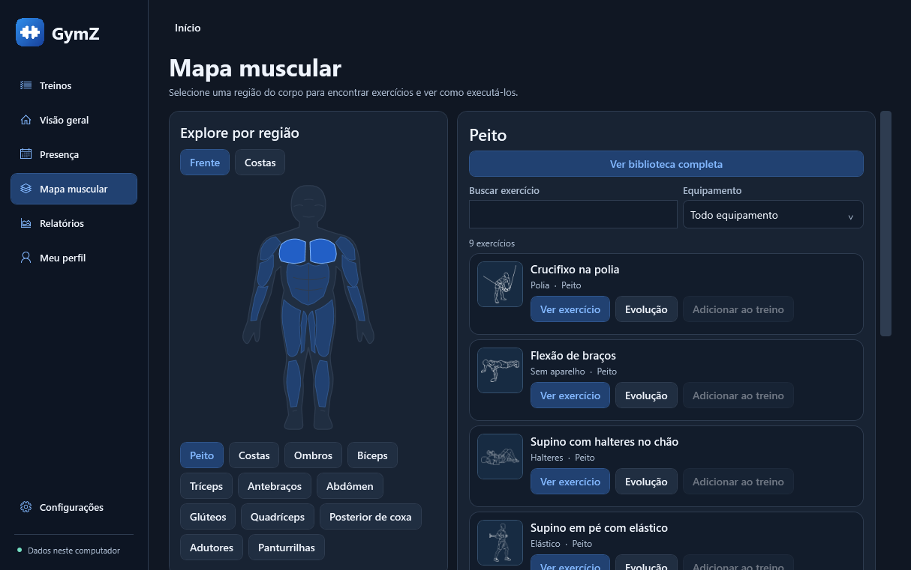
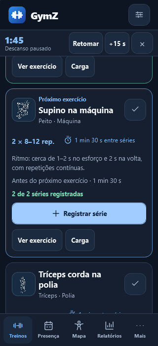

# GymZ

Planejador e diário de treinos para **Windows, Android e iPhone**. O GymZ transforma objetivos, dias disponíveis e equipamentos em um plano semanal. Na academia, abre direto no treino do dia e guarda presença, séries e cargas no próprio aparelho.

<p>
  <a href="https://github.com/jordaozz/GymZ/releases/latest/download/GymZ-Windows.zip"></a>
  <a href="https://github.com/jordaozz/GymZ/releases/latest/download/GymZ-Mobile.zip"></a>
</p>

[Guia de uso](docs/uso-e-referencias.md) · [Versão para celular](mobile/README.md) · [Todas as versões](https://github.com/jordaozz/GymZ/releases)

| Mapa muscular no Windows | Treino e timer no celular |
| --- | --- |
|  |  |

## O que o app faz

- **Planeja a semana.** Escolha a divisão por músculos, a região prioritária e os equipamentos. O plano ajusta o volume, sugere cardio conforme o objetivo e usa a cobertura da semana para orientar os próximos treinos.
- **Acompanha a execução.** Registre séries, cargas, repetições e esforço. Consulte 78 exercícios ilustrados e opções equivalentes para trocar, inclusive quando um aparelho está ocupado.
- **Registra presença e evolução.** Veja faltas, reposições, sessões extras e um relatório de músculos trabalhados. Exporte o relatório semanal em CSV.
- **Facilita o uso no celular.** Registre séries no cartão, recupere rascunhos, volte ao exercício de origem e acompanhe o timer de descanso enquanto navega.

## Instalação

| Plataforma | Como abrir |
| --- | --- |
| Windows 10 ou 11 | Baixe o pacote para Windows, extraia a pasta e abra `GymZ.exe`. |
| Android e iPhone | Abra a versão web em um endereço HTTPS e adicione à tela de início. A primeira abertura prepara os arquivos para uso offline. Consulte o [guia da versão móvel](mobile/README.md). |

Os dados ficam no armazenamento local do aplicativo. Em **Configurações**, exporte ou restaure o arquivo `gymz-backup.json` para transferir o histórico entre Windows e celular. O app oferece tema claro e escuro, cores de destaque, ajuste de texto e alto contraste.

## Código e desenvolvimento

O aplicativo Windows usa **C# e WPF**. A versão móvel é uma **PWA com Blazor WebAssembly**. As duas compartilham a lógica de treino, o catálogo, as ilustrações e o formato dos backups.

| Caminho | Responsabilidade |
| --- | --- |
| `Training.cs`, `WeeklySplit.cs`, `CardioPlan.cs` | Geração e adaptação do plano de treino |
| `Exercises.txt`, `assets/exercise-art/` | Catálogo e ilustrações |
| `Storage.cs` | Validação, leitura e gravação de backups |
| `mobile/` | Interface móvel, rascunhos, timer e cache offline |

**Windows**. Na raiz do projeto, use o PowerShell e o .NET Framework do Windows.

```powershell
.\build.ps1
Start-Process .\GymZ.exe -ArgumentList '--self-test', 'work\qa' -Wait -PassThru -WindowStyle Hidden
Get-Content .\work\qa\resultado.txt
```

**Celular**. Compile com o SDK .NET 10 e abra a prévia local com o Node.js.

```powershell
dotnet publish mobile/GymZ.Mobile.csproj -c Release -o work/mobile-build
node mobile/serve.mjs work/mobile-build/wwwroot
```

## Créditos

As ilustrações selecionadas do Workout Guide mantêm a autoria de Bryl Lim e Everkinetic e a licença CC BY-SA 4.0. Os créditos por imagem estão no catálogo de atribuições. [Atribuições](assets/exercise-art/Attribution.txt) · [Texto da licença](assets/exercise-art/LICENSE.txt)

O [guia de uso](docs/uso-e-referencias.md) reúne as fontes de técnica de exercício, planejamento e catálogo de máquinas. Os pacotes da versão móvel incluem os avisos de terceiros do runtime .NET e do Blazor.
